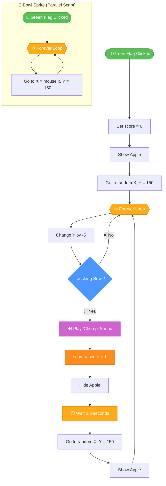

<div align="center">

<!-- ═══════════════ BANNER (dark / light aware) ═══════════════ -->
<picture>
  <source media="(prefers-color-scheme: dark)" srcset="https://capsule-render.vercel.app/api?type=waving&height=260&color=gradient&customColorList=12,20,24,30&text=Catch%20an%20Apple&fontSize=64&fontColor=ffffff&fontAlignY=38&animation=fadeIn&desc=A%20Scratch%202D%20Game%20%E2%80%A2%20Move%20%E2%80%A2%20Catch%20%E2%80%A2%20Score&descSize=20&descAlignY=60&stroke=ffffff&strokeWidth=1">
  <source media="(prefers-color-scheme: light)" srcset="https://capsule-render.vercel.app/api?type=waving&height=260&color=gradient&customColorList=0,2,5,12&text=Catch%20an%20Apple&fontSize=64&fontColor=ffffff&fontAlignY=38&animation=fadeIn&desc=A%20Scratch%202D%20Game%20%E2%80%A2%20Move%20%E2%80%A2%20Catch%20%E2%80%A2%20Score&descSize=20&descAlignY=60&stroke=ffffff&strokeWidth=1">
  
</picture>

<!-- ═══════════════ ANIMATED TAGLINE ═══════════════ -->
<a href="https://github.com/YOUR_USERNAME/catch-an-apple">
  
</a>

<br/><br/>

<!-- ═══════════════ BADGES ═══════════════ -->
<a href="https://scratch.mit.edu/">
  
</a>


<a href="https://www.youtube.com/watch?v=7NN5v2wSL4U">
  
</a>

<br/>


<br/><br/>

<!-- ═══════════════ QUICK NAV ═══════════════ -->
<kbd>[🎮 Overview](#-overview)</kbd>
<kbd>[🕹️ Controls](#️-controls)</kbd>
<kbd>[⚙️ Mechanics](#️-game-mechanics)</kbd>
<kbd>[🧩 Code](#-scratch-code)</kbd>
<kbd>[🔀 Flow](#-execution-flowchart)</kbd>
<kbd>[🚀 Run](#-getting-started)</kbd>
<kbd>[📺 Tutorial](#-video-tutorial)</kbd>

</div>

<br/>

---

## 🎮 Overview

> **Catch an Apple** is a fast, lightweight **Scratch 2D arcade game**. Apples fall from the sky, and you control a bowl with your mouse to catch as many as you can. Every catch plays a satisfying **Chomp** sound and raises your score.

It's a perfect first project for anyone learning **game loops, collision detection, variables, and randomness** in Scratch.

<div align="center">

| 🍎 Falls | 🥣 Catch | 🔊 Chomp | 🏆 Score |
|:---:|:---:|:---:|:---:|
| Random top spawn | Mouse-controlled bowl | Sound feedback | +1 per apple |

</div>

---

## ✨ Features

| Feature | Description | Status |
|:--|:--|:--:|
| 🖱️ **Mouse Control** | Bowl tracks the cursor horizontally in real time | ✅ |
| 🍎 **Random Spawning** | Apple appears at a random X position at the top | ✅ |
| ⬇️ **Continuous Falling** | Apple moves down by `-5` every frame | ✅ |
| 💥 **Collision Detection** | Detects when the apple touches the bowl | ✅ |
| 🔊 **Sound Effects** | Plays the `Chomp` sound on every catch | ✅ |
| 🔢 **Live Scoring** | `score` increases by `+1` per catch | ✅ |
| ⏱️ **Respawn Delay** | 0.3-second pause before the next apple | ✅ |
| 🔄 **Auto Reset** | Score resets to `0` on Green Flag click | ✅ |

---

## 🕹️ Controls

<div align="center">

| Input | Action | Details |
|:--:|:--|:--|
| 🖱️ **Mouse Move** | Move the bowl | Bowl's X follows `mouse x` |
| 🏁 **Green Flag** | Start / restart game | Resets score and starts loops |
| 🛑 **Stop Button** | End the game | Stops all scripts |

</div>

```text
┌──────────────────────────────────────────────┐
│                 CONTROL SCHEME               │
├──────────────────────────────────────────────┤
│  Bowl X  →  mouse x   (follows cursor)       │
│  Bowl Y  →  -150      (fixed on screen)      │
│  Axis    →  Horizontal movement only         │
└──────────────────────────────────────────────┘
```

---

## ⚙️ Game Mechanics

```text
╔══════════════════════════════════════════════════════╗
║                    STAGE LAYOUT                      ║
║                                                      ║
║                    🍎  (y = 150)                     ║
║                    │   spawn at random X             ║
║                    ▼   change y by -5 each frame     ║
║                    │                                 ║
║                    │                                 ║
║                    ▼                                 ║
║               ╭─────────╮                            ║
║               │  🥣 BOWL │  (y = -150)               ║
║               ╰─────────╯  x = mouse x               ║
║                                                      ║
║   SCORE: 0                                           ║
╚══════════════════════════════════════════════════════╝
```

| # | Mechanic | Rule |
|:-:|:--|:--|
| 1️⃣ | **Spawn** | Apple appears at `y = 150` with a random `x` |
| 2️⃣ | **Fall** | `change y by -5` inside a `forever` loop |
| 3️⃣ | **Catch** | `if touching Bowl` → play `Chomp`, `score +1` |
| 4️⃣ | **Hide & Wait** | Apple hides, then `wait 0.3 seconds` |
| 5️⃣ | **Respawn** | Apple returns to the top at a new random `x` and shows again |
| 6️⃣ | **Reset** | `set score to 0` on 🏁 Green Flag |

---

## 🧩 Scratch Code

### 🥣 Sprite 1: Bowl

```scratch
when green flag clicked
forever
go to x: (mouse x) y: (-150)
end
```

### 🍎 Sprite 2: Apple

```scratch
when green flag clicked
set [score v] to (0)
show
go to x: (pick random (-200) to (200)) y: (150)
forever
change y by (-5)
if <touching [Bowl v]?> then
start sound [Chomp v]
change [score v] by (1)
hide
wait (0.3) seconds
go to x: (pick random (-200) to (200)) y: (150)
show
end
end
```

> 💡 **Note:** GitHub doesn't render Scratch blocks natively. Paste the code above into the [scratchblocks live editor](https://scratchblocks.github.io/) to preview it visually.

### 📦 Pseudo-code Overview

```text
┌─────────────────────────────────────────────────────┐
│  🥣 BOWL                                            │
│  ───────────────────────────────────────────────    │
│  WHEN 🏁 clicked                                    │
│    FOREVER                                          │
│      go to (mouse x, -150)                          │
│                                                     │
├─────────────────────────────────────────────────────┤
│  🍎 APPLE                                           │
│  ───────────────────────────────────────────────    │
│  WHEN 🏁 clicked                                    │
│    score ← 0                                        │
│    show; go to (random x, 150)                      │
│    FOREVER                                          │
│      y ← y - 5                                      │
│      IF touching Bowl THEN                          │
│        play "Chomp"                                 │
│        score ← score + 1                            │
│        hide                                         │
│        wait 0.3s                                    │
│        go to (random x, 150)                        │
│        show                                         │
└─────────────────────────────────────────────────────┘
```

---

## 🔀 Execution Flowchart



---

## 🔍 Step-by-Step Code Breakdown

<details>
<summary><b>🥣 Step 1 — Bowl follows the mouse</b></summary>

<br/>

```scratch
when green flag clicked
forever
go to x: (mouse x) y: (-150)
end
```

| Block | Purpose |
|:--|:--|
| `when green flag clicked` | Starts the script when the game begins |
| `forever` | Updates the position every frame |
| `go to x: (mouse x) y: (-150)` | Bowl's X matches the cursor, Y stays locked at `-150` |

✅ **Result:** the bowl glides left and right with your cursor.

</details>

<details>
<summary><b>🔢 Step 2 — Initialize the score</b></summary>

<br/>

```scratch
when green flag clicked
set [score v] to (0)
```

Create a variable named **`score`** (*For all sprites*) and reset it at game start so every round begins from zero.

✅ **Result:** clicking 🏁 always starts a fresh game.

</details>

<details>
<summary><b>🍎 Step 3 — Spawn the apple</b></summary>

<br/>

```scratch
show
go to x: (pick random (-200) to (200)) y: (150)
```

| Block | Purpose |
|:--|:--|
| `show` | Makes sure the apple is visible |
| `pick random -200 to 200` | Picks a random horizontal spot |
| `y: 150` | Places the apple at the top of the stage |

✅ **Result:** each apple starts from an unpredictable position.

</details>

<details>
<summary><b>⬇️ Step 4 — Make the apple fall</b></summary>

<br/>

```scratch
forever
change y by (-5)
end
```

Subtracting `5` from Y every frame produces a smooth, constant downward motion. Use a larger negative number for a harder game and a smaller one for an easier game.

✅ **Result:** the apple continuously drops toward the bowl.

</details>

<details>
<summary><b>💥 Step 5 — Detect the catch</b></summary>

<br/>

```scratch
if <touching [Bowl v]?> then
start sound [Chomp v]
change [score v] by (1)
hide
end
```

| Action | Why it matters |
|:--|:--|
| `touching Bowl?` | Collision check between the two sprites |
| `start sound Chomp` | Instant audio feedback |
| `change score by 1` | Rewards the player |
| `hide` | Removes the caught apple visually |

✅ **Result:** every catch feels satisfying and is counted.

</details>

<details>
<summary><b>🔁 Step 6 — Delay and respawn</b></summary>

<br/>

```scratch
wait (0.3) seconds
go to x: (pick random (-200) to (200)) y: (150)
show
```

After the short pause, the apple teleports back to the top at a new random `x` and becomes visible, so the loop keeps going.

✅ **Result:** an endless, unpredictable stream of apples.

</details>

<details>
<summary><b>🧠 Concepts you'll learn</b></summary>
